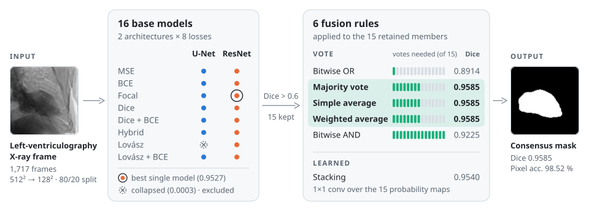
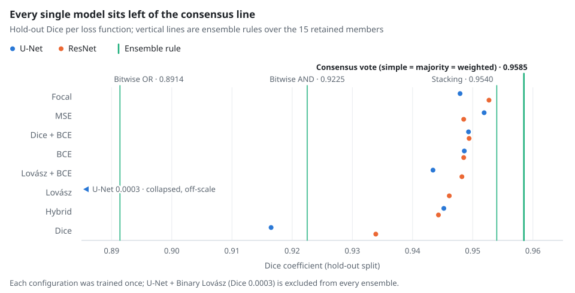
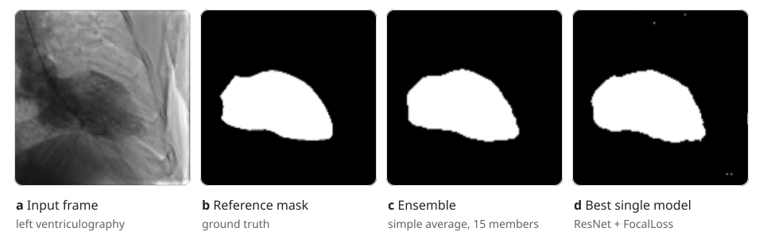

# Ensemble Learning Framework for Cardiac Systolic Abnormality Segmentation in Catheterization X-ray Images

**Masoud Noroozi**<sup>1</sup> · **Hossein Arabi**<sup>2</sup> · **Habib Zaidi**<sup>2</sup>

<sup>1</sup> Department of Biomedical Engineering, Faculty of Engineering, University of Isfahan, Isfahan, Iran<br>
<sup>2</sup> Division of Nuclear Medicine & Molecular Imaging, Geneva University Hospital, Geneva, Switzerland

*2024 IEEE Nuclear Science Symposium (NSS), Medical Imaging Conference (MIC) and<br>Room Temperature Semiconductor Detector Conference (RTSD)*

<div align="center">
  
[](https://ieeexplore.ieee.org/document/10657181)
[](https://doi.org/10.1109/NSS/MIC/RTSD57108.2024.10657181)
[](https://www.kaggle.com/datasets/c7934597/cardiac-catheterization)
[](https://pytorch.org)
[](https://colab.research.google.com/github/USERNAME/REPOSITORY/blob/main/Ensemble_Models.ipynb)

[Overview](#overview) · [Method](#method) · [Results](#results) · [Reproduce](#reproduce) · [Citation](#citation)

</div>

<br>

<picture>
  <source media="(prefers-color-scheme: dark)" srcset="assets/framework-dark.svg">
  
</picture>

<p align="center"><sub>Each dot is one base model. The vote strips show how many of the 15 retained members must agree before a pixel is labelled foreground.</sub></p>

<div align="center">

| **0.9585** | **98.52 %** | **+0.0058** | **0.82 M** |
|:---:|:---:|:---:|:---:|
| Dice, consensus vote | pixel accuracy | Dice over the best single model | parameters, all 15 members |

</div>

## Overview

Left ventriculography is a standard way to assess ejection fraction, hypertrophy and regional systolic abnormalities, yet reading it still depends largely on subjective visual interpretation. This repository contains the complete pipeline behind our IEEE NSS MIC RTSD 2024 paper: it trains a grid of lightweight segmentation networks on **1,717 cardiac catheterization X-ray frames** and measures how six ways of combining them change segmentation quality.

- **Two architectures × eight losses.** A plain U-Net and a residual variant ("ResNet"), each trained with MSE, BCE, Focal, Dice, Dice + BCE, Hybrid, Binary Lovász and Lovász + BCE losses: 16 base models.
- **Six fusion rules.** Simple average, majority voting, weighted average, bitwise AND, bitwise OR and a learned stacking head.
- **Ensembling pays off.** Consensus voting reaches **Dice 0.9585** and **98.52 % pixel accuracy**, above every base model (best: ResNet + FocalLoss, 0.9527 and 98.35 %).
- **Tiny by design.** 53 k (U-Net) and 56 k (ResNet) parameters per model; the full ensemble stays under one million.

## Method

### Data

| Aspect | Setting |
|---|---|
| Source | *Cardiac Catheterization X-Ray PNG 512×512* (W.-M. Lin, Kaggle) |
| Content | 1,717 left-ventriculography X-ray frames with binary reference masks |
| Pre-processing | grayscale, resized 512 → 128 px, intensities scaled to [0, 1] |
| Split | random 80 / 20 hold-out (seed 0): 1,373 training and 344 test frames |

### Base models

Both networks share one encoder–decoder topology with four down- and four up-sampling stages; the residual variant adds a 1×1-convolution projection shortcut to every block, `x ↦ DoubleConv(x) + Conv1×1(x)`.

| | U-Net | ResNet (residual U-Net) |
|---|---|---|
| Encoder stage | max-pool → 2 × (3×3 conv · BN · ReLU) | same + 1×1 projection shortcut |
| Decoder stage | bilinear ×2 → concatenate skip → 2 × (3×3 conv · BN · ReLU) | same + 1×1 projection shortcut |
| Channel widths | 4 · 8 · 16 · 32 · 32 | 4 · 8 · 16 · 32 · 32 |
| Output | 1×1 convolutional head, sigmoid | 1×1 convolutional head, sigmoid |
| Parameters | 53,059 | 56,491 |
| MACs per 128 × 128 frame (`thop`) | 33.9 M | 36.3 M |

### Loss functions

| Family | Losses |
|---|---|
| Pixel-wise | `MSELoss` · `BCELoss` · `FocalLoss` (α = 0.5, γ = 2) |
| Overlap-based | `DiceLoss` (soft Dice) · `BinaryLovaszLoss` (Lovász hinge, from pytorch-toolbelt) |
| Compound | `DiceBCELoss` (½ Dice + ½ BCE) · `LovaszBCELoss` (BCE + Lovász) · `HybridLoss` (BCE, Dice and a Sobel boundary-length term) |

### Fusion rules

Ensemble members are the base models whose hold-out Dice exceeds 0.6, which keeps **15 of the 16** (U-Net + Binary Lovász collapsed). The members are frozen; every rule except stacking works on their binarized masks (threshold 0.5).

| Rule | A pixel is foreground when… | Learned |
|---|---|:---:|
| Simple average | the mean of the 15 binary votes exceeds 0.5 | |
| Majority voting | more than ⌊15 / 2⌋ = 7 members vote for it | |
| Weighted average | ∑ wᵢ · voteᵢ > 0.5, with w = softmax of each member's hold-out Dice | |
| Bitwise AND | all 15 members agree (intersection) | |
| Bitwise OR | at least one member votes for it (union) | |
| Stacking | a 1×1 convolution over the 15 stacked probability maps (18 parameters), trained with BCE | ✓ |

## Results

All numbers are from Table I of the paper: hold-out test split, threshold 0.5, final epoch. *Accuracy* is pixel accuracy.

**Base models**

| Loss function | U-Net accuracy | U-Net Dice | ResNet accuracy | ResNet Dice |
|---|:---:|:---:|:---:|:---:|
| `MSELoss` | **0.9834** | **0.9519** | 0.9820 | 0.9485 |
| `BCELoss` | 0.9821 | 0.9486 | 0.9822 | 0.9485 |
| `FocalLoss` | 0.9820 | 0.9479 | **0.9835** | **0.9527** |
| `DiceLoss` | 0.9704 | 0.9165 | 0.9768 | 0.9339 |
| `DiceBCELoss` | 0.9822 | 0.9493 | 0.9823 | 0.9494 |
| `HybridLoss` | 0.9816 | 0.9452 | 0.9813 | 0.9443 |
| `BinaryLovaszLoss` | 0.8456 | 0.0003 † | 0.9817 | 0.9461 |
| `LovaszBCELoss` | 0.9811 | 0.9434 | 0.9823 | 0.9482 |

<sub>† Collapsed during training and excluded from every ensemble. Bold marks the best value per column.</sub>

**Ensembles** (15 members)

| Fusion rule | Accuracy | Dice | Δ Dice vs. best single model |
|---|:---:|:---:|:---:|
| Simple average | **0.9852** | **0.9585** | +0.0058 |
| Majority voting | **0.9852** | **0.9585** | +0.0058 |
| Weighted average | **0.9852** | **0.9585** | +0.0058 |
| Stacking | 0.9838 | 0.9540 | +0.0013 |
| Bitwise AND | 0.9759 | 0.9225 | −0.0302 |
| Bitwise OR | 0.9611 | 0.8914 | −0.0613 |

<br>

<picture>
  <source media="(prefers-color-scheme: dark)" srcset="assets/results-dark.svg">
  
</picture>

**Key findings**

1. **Consensus voting is the best rule.** Simple average, majority voting and weighted average all reach Dice 0.9585, above every one of the 15 base models.
2. **Learned fusion helps, but less.** The 18-parameter stacking head (0.9540) also beats every base model, yet not the parameter-free vote.
3. **Extreme votes hurt.** Unanimity (bitwise AND) keeps only pixels that all members agree on and falls to 0.9225, below 14 of the 15 members; accepting any single vote (bitwise OR) grows the mask to the union and falls to 0.8914, below all of them.
4. **The loss matters more than the architecture.** For six of the eight losses, U-Net and ResNet differ by at most 0.005 Dice, while changing the loss moves the converged models by up to 0.035 (U-Net) and 0.019 (ResNet). Dice loss alone gave the weakest converged models.
5. **The residual variant converged under every loss,** whereas U-Net collapsed under Binary Lovász.

> [!NOTE]
> **Why do three rules tie exactly?** Each non-learned rule is a *k-of-15* vote on binarized masks: bitwise OR is k = 1, majority voting is k = 8 and bitwise AND is k = 15. Averaging the 15 votes and thresholding at 0.5 is also k = 8. So is the weighted average: a softmax over member Dice scores between 0.9165 and 0.9527 gives weights of 6.48–6.72 %, so any 8 members always outweigh any 7. The three rules therefore produce identical masks, and identical scores.

**Qualitative example**

<picture>
  <source media="(prefers-color-scheme: dark)" srcset="assets/qualitative-dark.svg">
  
</picture>

<sub>Fig. 1 of the paper. The ensemble (c) returns one clean region, while the best single model (d) leaves a few isolated foreground specks near the image border.</sub>

## Reproduce

### Option A: Google Colab (as used for the paper)

1. Download the dataset from [Kaggle](https://www.kaggle.com/datasets/c7934597/cardiac-catheterization) and save the archive in Google Drive as `MyDrive/cardiac-catheterization.zip`.
2. Open the notebook with the **Open in Colab** badge above and choose a GPU runtime (*Runtime → Change runtime type → T4 GPU*).
3. Select *Runtime → Run all*. The notebook installs its dependencies, mounts Drive, unzips the data, trains the 16 base models, builds the 6 ensembles and prints both rankings by Dice.

### Option B: local machine

```bash
git clone https://github.com/USERNAME/REPOSITORY.git
cd REPOSITORY
pip install torch numpy opencv-python scikit-learn matplotlib jupyter \
            pytorch-toolbelt torchinfo einops medpy torchmetrics thop

# dataset (Kaggle CLI with an API token, or download it from the dataset page)
kaggle datasets download -d c7934597/cardiac-catheterization
unzip cardiac-catheterization.zip -d dataset

jupyter notebook Ensemble_Models.ipynb
```

Skip the two Colab-only cells (Drive mount and unzip). The notebook expects this layout:

```text
dataset/
└── Cardiac_Catheterization/
    └── train/
        ├── images/   # X-ray frames (PNG)
        └── masks/    # binary reference masks (PNG)
```

### Protocol at a glance

| Setting | Value | Where in the notebook |
|---|---|---|
| Input | 1 × 128 × 128, intensities in [0, 1] | `image_size = 128` |
| Hold-out split | 80 / 20, seed 0 | `train_test_split(..., test_size=0.2, random_state=0)` |
| Optimizer | Adam, learning rate 1 × 10⁻³ | `ModelFit` default |
| Batch size | 16 | `batch_size = 16` |
| Epochs | 10 per model, and for the stacking head | `epochs = 10` |
| Base width | 4 channels | `f = 4` in `Model` |
| Ensemble members | base models with hold-out Dice > 0.6 | `filter(lambda x: x[2] > 0.6, result)` |
| Decision threshold | 0.5 | all metrics and fusion rules |
| Reported metrics | pixel accuracy, Dice (mean over test batches) | the notebook also logs Jaccard, sensitivity, specificity, F1, HD95 and mIoU |
| Hardware | NVIDIA Tesla T4, 16 GB | Google Colab |

## Repository structure

```text
.
├── Ensemble_Models.ipynb   # full pipeline: data → 16 base models → 6 fusion rules
├── assets/                 # README figures (light and dark variants)
└── README.md
```

## Citation

If this work is useful for your research, please cite:

```bibtex
@inproceedings{noroozi2024ensemble,
  author    = {Noroozi, Masoud and Arabi, Hossein and Zaidi, Habib},
  title     = {Ensemble Learning Framework for Cardiac Systolic Abnormality Segmentation in Catheterization {X}-ray Images},
  booktitle = {2024 IEEE Nuclear Science Symposium (NSS), Medical Imaging Conference (MIC) and Room Temperature Semiconductor Detector Conference (RTSD)},
  pages     = {1--2},
  year      = {2024},
  publisher = {IEEE},
  doi       = {10.1109/NSS/MIC/RTSD57108.2024.10657181}
}
```

<details>
<summary>Plain-text reference</summary>

Masoud Noroozi, Hossein Arabi, and Habib Zaidi, "Ensemble learning framework for cardiac systolic abnormality segmentation in catheterization X-ray images," in *2024 IEEE Nuclear Science Symposium (NSS), Medical Imaging Conference (MIC) and Room Temperature Semiconductor Detector Conference (RTSD)*, 2024: IEEE, pp. 1–2, doi: [10.1109/NSS/MIC/RTSD57108.2024.10657181](https://doi.org/10.1109/NSS/MIC/RTSD57108.2024.10657181).

</details>

## Acknowledgements

- **Data:** W.-M. Lin, [*Cardiac Catheterization X-Ray PNG 512×512*](https://www.kaggle.com/datasets/c7934597/cardiac-catheterization), Kaggle. Please follow the dataset's terms of use.
- **Software:** [PyTorch](https://pytorch.org), [pytorch-toolbelt](https://github.com/BloodAxe/pytorch-toolbelt) (Lovász loss), [TorchMetrics](https://github.com/Lightning-AI/torchmetrics), [MedPy](https://github.com/loli/medpy) (HD95) and [THOP](https://github.com/Lyken17/pytorch-OpCounter) (complexity).

## License

Code is released under the terms in [`LICENSE`](LICENSE). The dataset is subject to its Kaggle terms of use.

## Contact

For questions or bug reports, please open a [GitHub issue](../../issues).


> [!CAUTION]
> **Research use only.** This software is not a medical device and has not been validated for clinical decision-making.
